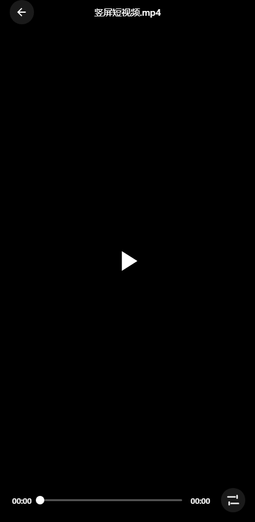

# 本地视频播放器（Local Video Player）

一个基于 **Capacitor 7 + Android 原生插件** 的本地视频播放器：启动自动扫描本机视频，按所在文件夹归类展示，点击文件夹浏览、点击视频即播。支持竖滑切换、全屏、倍速/画中画/亮度/音量调节、缩略图、下拉刷新与系统返回键逐层返回。




## ✨ 功能特性

- **媒体库扫描**
  - 启动自动扫描本机视频（MediaStore），按**文件夹路径**分组归类。
  - **流式扫描**：边扫边把已发现的文件夹实时展示（进度可见）。
  - 每个文件夹卡片显示：文件夹名、完整路径、视频数量、总时长、首帧缩略图。
  - **下拉刷新**替代手动刷新按钮。
- **播放**
  - 点击文件夹 → 视频列表 → 点击播放；**播放范围限定在该文件夹内**（竖滑只在该文件夹切换）。
  - 竖滑切换视频（触发阈值为视口高度 8%，灵敏可调）；双击画面中央切换放大/复位（2.5×），双击左/右边缘快退/快进 15 秒；单击显隐控制栏。
  - **全屏**：真机走系统原生横屏锁定（避免 WebView 旋转黑屏）。
  - 设置抽屉：倍速、画中画、亮度、音量。
  - **防黑屏**：首帧前用缩略图作 poster，点播放补缓冲期间用独立封面层遮挡，平滑过渡无闪烁。
  - **画面缩放**：双击画面中央在原始尺寸 ↔ 2.5× 间切换；双指捏合自由缩放（范围 1×–4×）；缩放后单指拖动平移并自动钳制边界；右下角「↺」按钮一键复位；`Ctrl`+滚轮也可缩放。缩放全程走 GPU 合成层（`translate3d` + `scale`），不触发重排。
  - 切换视频时保持控制栏、进度条等组件原有的隐藏状态（不会因切片被误显，仅用户单击才恢复显示）。
- **交互/系统**
  - 系统返回键逐层返回：播放器 → 所在文件夹详情 → 主页 → 才退出应用（兼容预测性返回）。
  - 缩略图懒加载 + 缓存。

## 🧱 技术栈

- **Capacitor 7**（`@capacitor/core` / `@capacitor/android`）
- Web 层：原生 **HTML / CSS / JavaScript**（无前端框架）
- 原生：**Java** Capacitor 插件 `VideoScannerPlugin`
- 视频源：本地文件经 `MediaStore` → `content://` → `Capacitor.convertFileSrc` 由 WebView 播放

## 📁 目录结构

```
local-video-player-mobile/
├── www/                     # Web 层源码（capacitor 的 webDir）
│   ├── index.html
│   ├── app.js               # 媒体库 + 播放器 + 手势 + 导航逻辑
│   └── styles.css
├── tools/                   # 无头验证脚本（Node + 无头 Chrome，无需真机）
│   ├── mock-capacitor.js    # 注入假 Capacitor 桥 + 样本数据
│   ├── verify-library.js    # 媒体库/导航/下拉刷新/返回键 验证
│   └── verify-fullscreen.js # 全屏/转屏/播放按钮/缩放 回归验证
├── android/                 # Capacitor Android 工程
│   ├── app/src/main/java/com/localvideo/player/
│   │   ├── MainActivity.java         # 接管系统返回键（OnBackPressedDispatcher）
│   │   └── VideoScannerPlugin.java   # 扫描/缩略图/方向/退出 原生插件
│   ├── app/src/main/assets/public/   # cap sync 生成的打包资源（www 的副本，勿手改）
│   └── ...
├── capacitor.config.json
├── package.json
└── README.md
```

## 🔧 环境要求

- Node.js ≥ 20（运行验证脚本需 ≥ 21）
- JDK **21**（`compileOptions` 为 `VERSION_21`）
- Android Studio + Android SDK（`compileSdk 35` / `targetSdk 35` / `minSdk 23`，即支持 Android 6.0+）

## 🚀 构建与运行

```bash
# 1. 安装依赖
npm install

# 2. 同步 Web 资源到 Android（把 www/ 复制到 android/app/src/main/assets/public/）
npm run sync            # = npx cap sync android

# 3a. 用 Android Studio 打开并运行/调试
npm run open            # = npx cap open android

# 3b. 或命令行打包 debug APK
cd android
gradlew.bat assembleDebug
# 产物：android/app/build/outputs/apk/debug/app-debug.apk
```

> ⚠️ **对外分享的 APK 请用 `gradlew assembleDebug` 的产物**，不要直接分享 Android Studio「Run ▶」部署过的包——那种带 `testOnly` 标记，别人安装会报 `INSTALL_FAILED_TEST_ONLY (-15)`。

## 📱 权限

- Android 13（API 33）及以上：`READ_MEDIA_VIDEO`
- 更低版本：`READ_EXTERNAL_STORAGE`
- 首次启动自动申请；被拒后可前往系统设置授权，返回后自动重试扫描。

## 🔌 原生插件 `VideoScannerPlugin`

| 方法 | 说明 |
|---|---|
| `listVideos()` | 一次性返回全部视频 `{ videos:[{id,name,path,uri,duration,size,width,height,folder,folderPath}], count }` |
| `scanVideos()` | **流式扫描**：推送 `videoScanProgress` 事件（`{type:'folder'|'update', folder:{path,name,count,totalDuration,preview}}`），结束后 resolve 完整列表 |
| `checkPermission()` | 返回 `{ granted, permission }` |
| `openSettings()` | 打开系统应用设置页 |
| `setOrientation({orientation})` | `portrait` / `landscape` / `unlocked`（全屏用） |
| `getThumbnail({id,width,height})` | 生成视频缩略图，返回缓存 JPEG 的 `file://` URI |
| `exitApp()` | 退出应用（主页按返回键时调用） |

## ✅ 无头验证

不依赖真机，用无头 Chrome + mock 数据跑断言：

```bash
node tools/verify-library.js      # 媒体库/导航/下拉刷新/返回键（23 项断言）
node tools/verify-fullscreen.js   # 全屏/转屏/播放按钮/缩放 回归（36 项断言）
```

## ⚠️ 注意事项

- **release 签名未配置**：`android/app/build.gradle` 的 `release` 没有 `signingConfig`，`assembleRelease` 产物默认**未签名、不能直接安装**；正式分发前需配置签名密钥（密钥文件切勿提交进仓库，已在 `.gitignore` 预防性忽略）。
- `android/app/src/main/assets/public/` 是 `npx cap sync` 生成的 `www/` 副本，**不要手动修改**；改 Web 代码后重新 `npm run sync`。
- 调试签名库在 `~/.android/debug.keystore`（项目外），删除项目不影响。

## 📄 License

暂未指定 License，保留所有权利。
